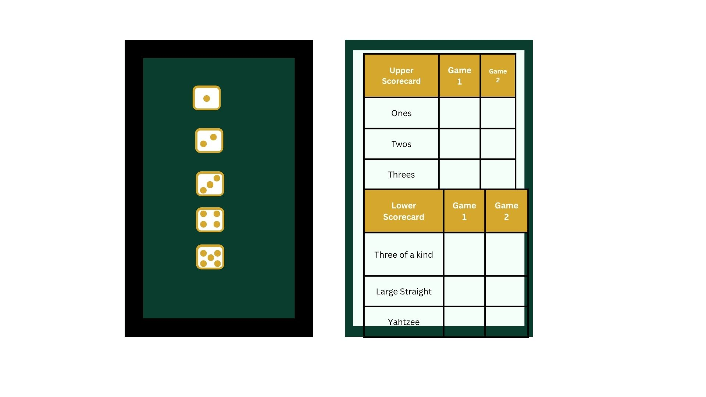

#Yatzy Game Design System

AUthor: Jamal St. Lewis
Class: CST3106 - Internet Architecture & Web Developpment
Assignment: Lab5

## Section 1: Project Overview
Documentation markdown for the lab5 project. This is overview of for the Yatzy project within this project.
Game functionality to follow at later labs/steps. This markdown will focus on design & colour scheme.
It will also include the rules.
### Scope
Components in the design 
- game header
- current player & turn
- five dice
- current die state & held dice
- game scorecard for Yatzy (includes both lower & upper sections)
- ideally desktop & mobile layouts

## Section 2: Game Rules

This game uses 5 dice. The scoring sheet is divided into upper and lower scoring categories. 

### Game Objective
The objective of the game is to score the most amount of points. A player acquires points by rolling dice during their turn to make different combinations. Various combinations earn a player a different amount of points. The points are recorded on the scoresheet. Each combination can only be used by a player once per game.

### Player Turn
1. Player takes all 5 dice
2. Player rolls all 5 dice
3. Player selects which dice to keep & which dice to roll again
3. 5 Goal is to make one of the combination that they have not yet completed on the card, in the highest possible combination
4. Player may repeat step 3. They can can roll at most 3 times per turn and must fill only 1 category per turn. No more & no less.
5. Record the chosen combination in the relevant scorecard category. 
6. End of Turn

** If they are unable to make a dice combination that fits one of the available scorecard categories, they must zero out one of their available scorecard categories.**
### Scorecard Scoring Categories

#### Uppper Section

|Category |Requirements| Scoring Calculation
|Ones| Dice with one face-up | Total of all ones
|Twos| Dice with two face-up | Total of all twos
|Threes| Dice with three face-up | Total of all threes
|Fours| Dice with four face-up | Total of all fours
|Fives| Dice with five face-up | Total of all fives
|Sixes| Dice with six face-up | Total of all sixes


*If the total of all points from the upper section is 63 or higher, an addition 35 points is gained*

#### Lower Section
|Category |Requirements| Scoring Calculation
|Three of a Kind|3 dice with same dice # face-up | Total of  3 dice with the same # face-up
|Four of a kind |4 dice with same dice # face-up | Total of  4 dice with the same # face-up
|Full house | Two dice with same # and other three dice all the same but different # | 25 points
|Small Straight | sequence of four dice (ex: 1-4) | 30 points
|Large Straight | Sequence of five dice (ex: 1-5) | 40 points
|YAHTZEE | all five dice same # face-up | 50 points
|Chance | any combination of five dice | total of all dice
|YAHTZEE Bonus | all five dice same # face-up for the second time | 100 (can be achieved twice)


#### Score counting
Sum of points from upper and lower section.

## Colour Palette
Dark green is the primary brand colour. Gold is used for accents, selected
states, and borders. White and off-white backgrounds support readable content.

| CSS token | Hex value | Intended use |
|---|---|---|
| `--green-dark` | `#0B3D2E` | gameplay background |
| `--gold` | `#D5A72C` | borders and accents |
| `--text` | `#1F2937` | Body text and score values |
### Colour Palette Rationalle
Matching with my existing colour palette. The dark green playing board with gold accents will pop and have a luxurious casino feel.
## Typography
The game uses the same font stack as my portfolio:

```css
font-family: Aptos, Arial, Helvetica, sans-serif;
```

Aptos is the preferred font. The other fonts provide fallbacks if it is not
available on the user's device.

| Element | Size | Weight | Purpose |
|---|---|---|---|
| Game title / h1 | `2.35rem` | 700 | Main page heading |
| Section heading / h2 | `1.5rem` | 700 | Dice, scorecard, and rules headings |
| Subheading / h3 | `1.15rem` | 700 | Smaller information groups |
| Body text | `1rem` | 400 | Rules and instructions |
| Buttons | `1rem` | 700 | Game actions |
| Supporting text | `0.95rem` | 400 | Status messages and labels |
| Score values | `1rem` | 700 | Scores and totals |

Body text uses `line-height: 1.6`.


## Typography Rationale
Consistent and clearly legiible font type. consistent fonts for easier downloads. Clear & bold headings
## Spacing

Following the 4px spacing scale. 
| Token | Value | Intended use |
|---|---|---|
| `--space-xs` | `4px` | Small label adjustments |
| `--space-sm` | `8px` | Tight gaps |
| `--space-md` | `16px` | Dice gaps and normal spacing |
| `--space-lg` | `24px` | Panel padding |
| `--space-xl` | `32px` | Main layout gaps |
| `--space-2xl` | `48px` | Larger section spacing |
| `--space-3xl` | `64px` | Large desktop spacing where needed |


## Dice Design

5 six-sided dice
- square with rounded edges
- white background

## Markup photo
 